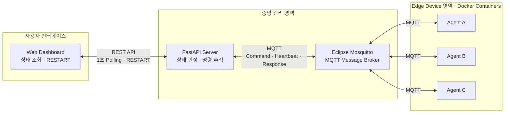
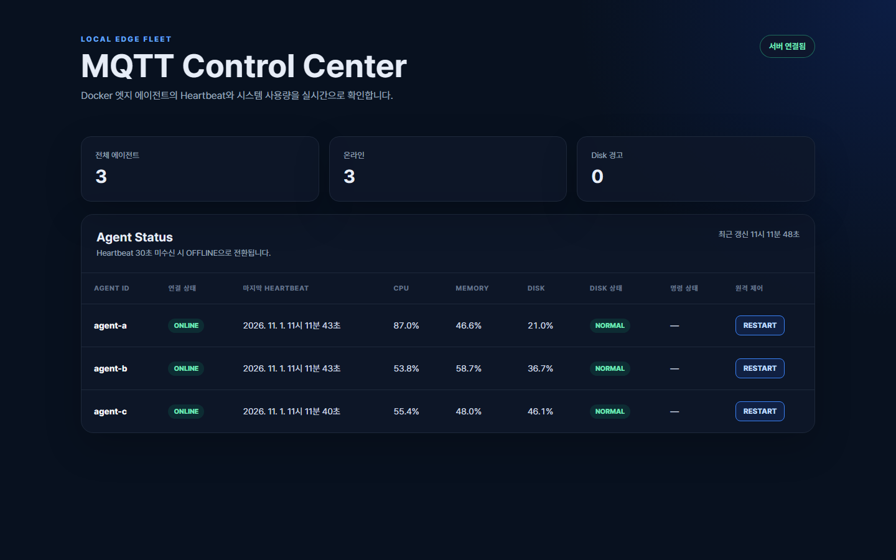
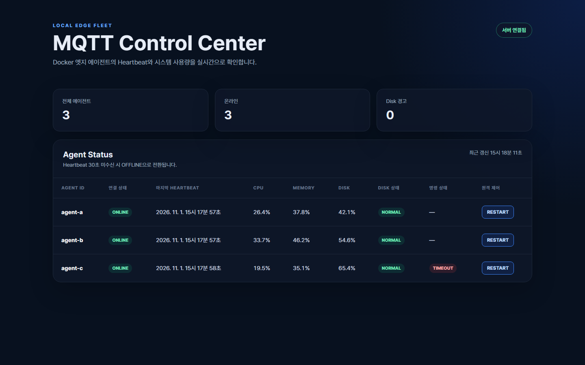
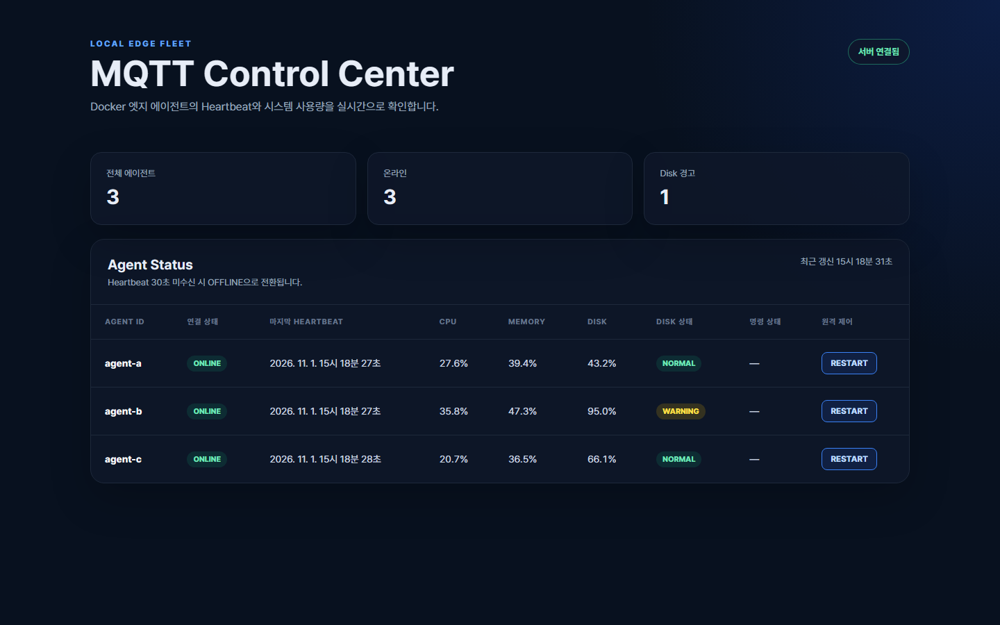

# MQTT Edge Control Center

Docker 컨테이너를 엣지 장비로 가정해 Agent 3개의 상태를 MQTT로 수집하고, 웹 대시보드에서 장애 감지와 원격 명령을 처리하는 로컬 모니터링 시스템입니다.

> 현재 구현 범위에서는 모든 구성 요소를 한 대의 PC에서 실행하며 외부 클라우드와 실제 하드웨어는 사용하지 않습니다.

## 요구사항 달성 현황

| 기능 | 구현 내용 | 상태 |
| --- | --- | :---: |
| MQTT Heartbeat | Agent A/B/C가 10초마다 CPU, Memory, Disk 상태를 JSON으로 발행 | ✅ |
| 실시간 모니터링 | 새로고침 없이 1초마다 Agent 상태 자동 갱신 | ✅ |
| 장애 감지와 복구 | 마지막 수신 후 30초 이상이면 OFFLINE, 재수신 시 ONLINE | ✅ |
| 원격 명령 | UUID Request ID 기반 RESTART Request/Response | ✅ |
| 비동기 예외 처리 | 즉시 HTTP 202 반환, 10초 무응답 시 TIMEOUT | ✅ |
| 임계치 알림 | Disk 사용률이 90%를 초과하면 노란색 WARNING | ✅ |
| 문서화 | 실행 방법, Topic/메시지 명세, 테스트, 상황별 캡처 | ✅ |

## 시스템 구조



- **Broker**: MQTT 메시지를 Topic 기준으로 중계합니다.
- **Server**: Heartbeat 수신, 상태 판정, 명령 발행, 응답 매칭과 API 제공을 담당합니다.
- **Agent A/B/C**: 같은 Docker 이미지를 사용하되 `AGENT_ID`가 다른 독립 엣지 장비입니다.
- **Dashboard**: 상태 API를 1초마다 조회하고 Agent별 RESTART 명령을 요청합니다.

## 기술 스택

| 구분 | 기술 | 버전 또는 방식 |
| --- | --- | --- |
| Language | Python | 3.13.18 slim, image digest 고정 |
| MQTT Broker | Eclipse Mosquitto | 2.0.22, image digest 고정 |
| MQTT Client | paho-mqtt | 2.1.0 |
| Backend | FastAPI | 0.115.12 |
| ASGI Server | Uvicorn | 0.34.2 |
| Frontend | HTML, CSS, JavaScript | 별도 프레임워크 없음 |
| Runtime | Docker Compose | v2, 검증 환경 2.35.1 |

## 빠른 실행

### 사전 조건

- Docker Desktop 또는 Docker Engine + Compose v2
- 호스트의 `127.0.0.1:1883`, `127.0.0.1:8000` 포트 사용 가능

Mosquitto는 Compose가 `eclipse-mosquitto:2.0` 이미지를 실행하므로 호스트에 별도로 설치할 필요가 없습니다.

### 저장소 실행

```powershell
git clone https://github.com/iseungho/mqtt-edge-control-center.git
cd mqtt-edge-control-center
docker compose up --build
```

백그라운드 실행:

```powershell
docker compose up -d --build
docker compose ps
```

구성 요소를 나눠 실행할 수도 있습니다.

```powershell
docker compose up -d broker server
docker compose up -d agent-a agent-b agent-c
```

접속 주소:

Compose는 로컬 실행 범위에 맞춰 Broker와 Dashboard 포트를 `127.0.0.1`에만 바인딩합니다. Agent 컨테이너는 호스트 포트가 아니라 Docker 내부 네트워크의 `broker:1883`으로 통신합니다.

| 용도 | 주소 |
| --- | --- |
| Dashboard | <http://localhost:8000> |
| Agent 상태 API | <http://localhost:8000/api/agents> |
| FastAPI 문서 | <http://localhost:8000/docs> |
| MQTT Broker | `localhost:1883` |

로그 확인과 종료:

```powershell
docker compose logs -f broker server agent-a agent-b agent-c
docker compose down
```

## 상태 판정 규칙

| 상태 | 판정 기준 |
| --- | --- |
| ONLINE | 마지막 Heartbeat 수신 후 30초 미만 |
| OFFLINE | 마지막 Heartbeat 수신 후 30초 이상 |
| NORMAL | `disk_usage <= 90` |
| WARNING | `disk_usage > 90` |
| PENDING | RESTART 명령 발행 후 응답 대기 중 |
| SUCCESS | 동일 Request ID의 정상 응답 수신 |
| TIMEOUT | 명령 발행 후 10초 동안 응답 없음 |

장애 시간은 Agent가 보낸 `timestamp`가 아니라 서버의 단조 시계로 계산합니다. Agent 시계가 잘못되거나 시스템 시간이 보정돼도 OFFLINE과 TIMEOUT 계산에 영향을 주지 않습니다.

## MQTT Topic 설계

| Topic | 방향 | QoS | 설명 |
| --- | --- | :---: | --- |
| `agents/{agent_id}/heartbeat` | Agent → Server | 1 | 10초 주기 상태 데이터 |
| `agents/{agent_id}/commands` | Server → Agent | 1 | Agent별 RESTART 요청 |
| `agents/{agent_id}/responses` | Agent → Server | 1 | Request ID를 포함한 처리 결과 |

전체 Heartbeat 확인:

```powershell
docker compose exec broker mosquitto_sub -t "agents/+/heartbeat" -v
```

### Heartbeat

```json
{
  "agent_id": "agent-a",
  "timestamp": "2026-11-01T00:00:00+00:00",
  "cpu_usage": 35.2,
  "memory_usage": 61.7,
  "disk_usage": 92.4
}
```

서버는 Topic과 Payload의 Agent ID 일치 여부, 시간대가 포함된 timestamp, 사용률의 숫자 타입과 0~100 범위를 검증합니다.

### RESTART 요청

```json
{
  "request_id": "73d215f2-50ce-4257-9f96-ae04afc37de5",
  "command": "RESTART",
  "status": "PENDING",
  "requested_at": "2026-11-01T00:00:00+00:00",
  "responded_at": null
}
```

### Agent 응답

```json
{
  "request_id": "73d215f2-50ce-4257-9f96-ae04afc37de5",
  "agent_id": "agent-a",
  "command": "RESTART",
  "status": "SUCCESS",
  "responded_at": "2026-11-01T00:00:01+00:00"
}
```

서버는 Agent ID와 Request ID가 현재 대기 중인 명령과 모두 일치할 때만 SUCCESS로 변경합니다. 10초가 지난 뒤 도착한 늦은 응답은 TIMEOUT을 덮어쓰지 않습니다.

## HTTP API

| Method | Path | 결과 |
| --- | --- | --- |
| `GET` | `/` | 대시보드 HTML |
| `GET` | `/api/agents` | 모든 Agent의 최신 상태 |
| `POST` | `/api/agents/{agent_id}/restart` | RESTART 접수, HTTP 202 |

명령 API는 Agent 응답을 기다리지 않고 즉시 반환합니다. MQTT Network Loop가 별도 스레드에서 동작하므로 명령 대기 중에도 Heartbeat와 대시보드 요청이 계속 처리됩니다.

## 프로젝트 구조

```text
mqtt-edge-control-center/
├─ agent/
│  ├─ agent.py                 # Heartbeat 발행, 명령 구독과 SUCCESS 응답
│  ├─ test_agent.py            # 정상 및 잘못된 RESTART 명령 테스트
│  ├─ Dockerfile
│  └─ requirements.txt
├─ server/
│  ├─ static/
│  │  ├─ index.html            # Dashboard
│  │  ├─ style.css
│  │  └─ app.js                # 1초 Polling과 RESTART 요청
│  ├─ app.py                   # MQTT 상태 관리와 FastAPI
│  ├─ test_app.py              # 상태 판정, 명령 처리, 입력 검증 테스트 4개
│  ├─ Dockerfile
│  └─ requirements.txt
├─ mosquitto/
│  └─ mosquitto.conf
├─ docs/images/                # 기능별 실행 결과 캡처
├─ docker-compose.yml
└─ README.md
```

## 기능별 실행 및 검증

각 화면은 설명된 명령과 조작을 실제 Docker 환경에서 실행한 결과입니다. 상태를 변경하는 테스트에는 마지막에 복구 명령을 함께 표시했습니다.

### 1. Agent 3개 ONLINE

**실행**

```powershell
docker compose up -d --build
docker compose ps
```

**확인할 결과**

- Agent A/B/C가 각각 독립된 컨테이너로 실행됩니다.
- 세 Agent가 ONLINE으로 표시되고 CPU, Memory, Disk 값이 10초마다 변경됩니다.
- 브라우저를 새로고침하지 않아도 화면이 1초마다 갱신됩니다.


### 2. Heartbeat 중단과 ONLINE 복구

**Agent B 중지**

```powershell
docker compose stop agent-b
Start-Sleep -Seconds 31
```

**확인할 결과**

- `agent-b`만 OFFLINE으로 전환됩니다.
- `agent-a`, `agent-c`의 Heartbeat와 대시보드는 계속 동작합니다.


**Agent B 복구**

```powershell
docker compose start agent-b
```

새 Heartbeat가 수신되면 Agent B가 별도 조작 없이 ONLINE으로 복구됩니다.



### 3. RESTART SUCCESS

**실행 단계**

1. <http://localhost:8000>에서 ONLINE Agent의 `RESTART` 버튼을 클릭합니다.
2. 서버가 고유한 Request ID를 생성하고 MQTT 명령을 발행합니다.
3. Agent가 같은 Request ID를 포함한 SUCCESS 응답을 반환합니다.

동일한 요청을 API로 실행할 수도 있습니다.

```powershell
Invoke-RestMethod -Method Post http://localhost:8000/api/agents/agent-a/restart
```

**확인할 결과**

- 명령 상태가 `PENDING`을 거쳐 `SUCCESS`로 변경됩니다.
- 명령 처리 중에도 다른 Agent의 Heartbeat와 화면 갱신은 멈추지 않습니다.


### 4. RESTART TIMEOUT

**Agent C 중지 후 명령 요청**

```powershell
docker compose stop agent-c
Invoke-RestMethod -Method Post http://localhost:8000/api/agents/agent-c/restart
Start-Sleep -Seconds 11
```

**확인할 결과**

- 응답을 기다리는 동안 `PENDING`이 표시됩니다.
- 10초 동안 같은 Request ID의 응답이 없으면 `TIMEOUT`으로 변경됩니다.
- 명령 TIMEOUT은 10초, 연결 OFFLINE 판정은 30초이므로 캡처 시점에는 Agent C가 `ONLINE + TIMEOUT`으로 표시될 수 있습니다.
- 서버와 나머지 Agent는 명령 대기 중에도 계속 동작합니다.



**Agent C 복구**

```powershell
docker compose start agent-c
```

### 5. Disk 90% 초과 WARNING

Agent B의 랜덤 Heartbeat가 테스트 값을 덮어쓰지 않도록 잠시 중지하고 Disk 95% 메시지를 발행합니다.

```powershell
docker compose stop agent-b
docker compose exec -T broker mosquitto_pub -h localhost -t "agents/agent-b/heartbeat" -q 1 -m '{"agent_id":"agent-b","timestamp":"2026-11-01T00:00:00+00:00","cpu_usage":20.0,"memory_usage":30.0,"disk_usage":95.0}'
```

**확인할 결과**

- Agent B의 Disk 값이 `95.0%`로 표시됩니다.
- Disk 상태와 상단 경고 수가 노란색 WARNING으로 갱신됩니다.



**Agent B 복구**

```powershell
docker compose start agent-b
```

### 6. 단위 테스트

시스템 실행 후:

```powershell
docker compose exec -T server python -m unittest
docker compose exec -T agent-a python -m unittest
```

시스템을 실행하지 않고 일회성 컨테이너로 실행:

```powershell
docker compose run --rm server python -m unittest
docker compose run --rm agent-a python -m unittest
```

서버 테스트 4개는 상태 판정, 명령 처리와 MQTT 입력 검증을 확인합니다. Agent 테스트 1개는 정상 RESTART 응답과 잘못된 명령 무시를 확인합니다.

## 설계 특성과 확장 전략

### 핵심 설계 원칙

- Broker, Server, Agent의 책임을 분리해 MQTT 메시지 흐름을 명확하게 구성했습니다.
- 같은 Agent 이미지를 환경 변수로 구분해 세 엣지 장비가 독립적으로 동작합니다.
- Request ID와 10초 TIMEOUT으로 비동기 명령의 요청과 응답을 추적합니다.
- 수신 데이터 검증, 공유 상태 Lock, 늦게 도착한 응답 무시 처리를 포함했습니다.
- Docker Compose 명령 하나로 전체 환경을 같은 조건에서 다시 실행할 수 있습니다.

### 구현 범위와 제약

현재 시스템은 로컬 PC에서 핵심 MQTT 흐름을 검증하는 데 집중했습니다. 상태와 명령 이력은 메모리에 저장되므로 서버를 재시작하면 초기화됩니다. CPU, Memory, Disk는 가상 데이터이며 RESTART도 실제 프로세스를 종료하지 않고 SUCCESS 응답으로 동작을 모의합니다. Agent가 3개인 환경에서는 별도 실시간 통신 계층을 추가하지 않고 1초 HTTP Polling으로 대시보드를 갱신합니다.

### 운영 환경 확장 전략

1. `psutil`을 이용해 실제 장비 지표를 수집합니다.
2. MQTT 계정 인증, ACL과 TLS를 적용합니다.
3. SQLite 또는 PostgreSQL에 상태와 명령 이력을 저장합니다.
4. Agent 수가 증가하면 WebSocket 또는 SSE 기반 Push 방식으로 전환합니다.
5. 이메일, Slack 또는 Webhook으로 장애와 임계치 경고를 전달합니다.

### 운영 리스크 및 고려사항

- 익명 Broker를 외부에 노출하면 허가되지 않은 메시지가 발행될 수 있습니다.
- 단일 Broker 장애는 모든 Agent와 서버의 MQTT 통신에 영향을 줍니다.
- Agent가 많아지면 1초 Polling과 메모리 상태 관리 비용이 증가합니다.
- QoS 1은 메시지를 중복 전달할 수 있으므로 실제 RESTART를 구현할 때는 Request ID 기반 중복 실행 방지가 필요합니다.
- 네트워크가 일시적으로 끊기면 대시보드 상태와 실제 장비 상태가 잠시 다를 수 있습니다.

현재 구현은 Heartbeat, 장애 감지와 복구, 비동기 명령, TIMEOUT, WARNING에 대한 정의된 요구사항을 모두 충족합니다. 운영 기능은 실제 지표 수집 → 인증/TLS → 상태 영속화 → Push 기반 대시보드 순서로 확장하는 것이 적절합니다.

## 검증 결과

2026-11-01 로컬 Docker 환경에서 다음 항목을 다시 검증했습니다.

| 검증 항목 | 결과 |
| --- | :---: |
| Compose 콜드 스타트와 이미지 재빌드 | PASS |
| 서버 단위 테스트 4개 | PASS |
| Agent 명령 테스트 1개 | PASS |
| Agent 3개 Heartbeat와 ONLINE | PASS |
| 30초 OFFLINE과 재실행 복구 | PASS |
| RESTART HTTP 202와 SUCCESS | PASS |
| PENDING에서 10초 TIMEOUT | PASS |
| Disk 95% WARNING | PASS |
| 1초 자동 갱신과 브라우저 콘솔 | PASS |
| Docker 런타임 예외 | 없음 |

## 로컬 보안 범위

`mosquitto.conf`는 로컬 재현을 위해 익명 접속을 허용하고 persistence를 사용하지 않습니다. 현재 Compose는 Broker와 Dashboard를 localhost에만 공개합니다. 서로 다른 네트워크의 장비를 연결하려면 포트 바인딩과 `MQTT_HOST`를 변경할 수 있지만, 그전에 계정 인증, ACL, TLS, 방화벽과 영속 저장소를 적용해야 합니다.
